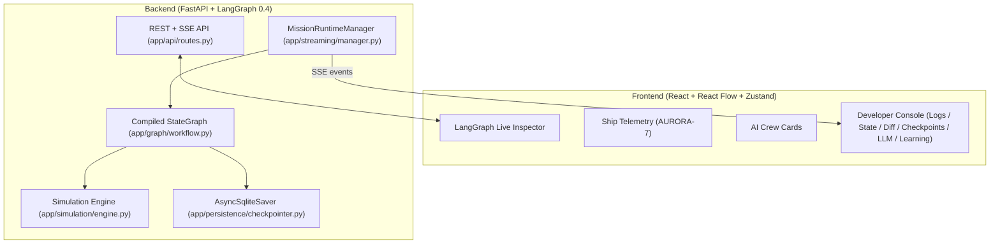

# LangGraph Architecture & Mechanisms Guide

This guide explains every LangGraph mechanism implemented in **AI Space Mission (AURORA-7)** — what it is, why it matters, where it lives in the codebase, how to observe it in the UI, and what you would have to build manually without LangGraph.

---

## System & Graph Diagrams

---

## LangGraph Mechanisms Breakdown

### 1. `StateGraph` & Typed `MissionState` (`TypedDict`)
1. **What it is**: A state-machine graph where nodes read a shared typed schema (`MissionState`) and return partial state dictionaries.
2. **Why it is needed**: Keeps all agent outputs, ship telemetry, iteration counters, plans, and errors strongly typed and centralized.
3. **How it is used here**: Every node returns only the keys it updates (e.g., `ship_state`, `current_plan`, `safety_assessment`) without mutating state in place.
4. **File**: `backend/app/state/mission_state.py`, `backend/app/graph/workflow.py`.
5. **How to see it in UI**: Open **Developer Console -> State** (JSON Tree View) and **State Diff** to watch individual fields update after each node.
6. **Without LangGraph**: You would manually pass a mutable context dictionary through ad-hoc functions, risking hidden mutations and race conditions during parallel execution.

---

### 2. Dynamic Routing with `Send()` (Fan-out / Parallel Execution)
1. **What it is**: A conditional-edge return value (`list[Send]`) that dynamically spawns parallel node executions at runtime.
2. **Why it is needed**: Different emergencies require different subsets of specialists (e.g., `engineer` + `medical_officer` for Engine Failure vs all three for Critical Cascade).
3. **How it is used here**: `route_to_specialists()` reads `state["selected_specialists"]` chosen by Commander and returns `[Send(name, state) for name in selected]`.
4. **File**: `backend/app/graph/routing.py` (`route_to_specialists`).
5. **How to see it in UI**: Watch multiple specialist nodes (`Engineer`, `Scientist`, `Medical Officer`) glow cyan simultaneously with the **Parallel Send() Branch** badge while unselected specialists show dashed `skipped` styling.
6. **Without LangGraph**: You would manually coordinate `asyncio.gather()`, track dynamic task lifecycles, and write custom fan-in barriers.

---

### 3. Custom Reducers (Fan-in & Iteration-Scoped Reset)
1. **What it is**: Functions attached via `Annotated[Type, reducer_fn]` that combine concurrent updates into a single state value.
2. **Why it is needed**: When parallel specialists finish in the same superstep, naive overwriting would drop reports; meanwhile, old reports from Iteration 1 must not pollute Iteration 2.
3. **How it is used here**:
   - `merge_specialist_reports`: merges parallel reports deduplicated by `(agent, iteration)` AND supports `{"__reset__": True}` emitted by Commander at the start of each cycle.
   - `append_list`: preserves immutable full history for `previous_plans`, `executed_actions`, `event_history`, and `errors`.
4. **File**: `backend/app/state/reducers.py`.
5. **How to see it in UI**: Click `plan_aggregator` or inspect `specialist_reports` in the **State** tab before and after Commander starts Iteration 2.
6. **Without LangGraph**: You would need explicit locks, merge functions, and manual cleanup logic between loop iterations.

---

### 4. Conditional Edges & Bounded Cyclic Workflows
1. **What it is**: Dynamic edges that branch based on state, allowing loops back to earlier nodes with explicit termination guards.
2. **Why it is needed**: Real multi-agent systems must revise rejected plans and iterate until objectives are met without entering infinite loops.
3. **How it is used here**:
   - `route_after_safety`: routes rejected plans back to `commander` (with a safety revision cap) and approved plans to `human_approval`.
   - `route_after_evaluation`: loops back to `commander` if stabilization is incomplete and `iteration < max_iterations`, otherwise routes to `END`.
4. **File**: `backend/app/graph/routing.py` (`route_after_safety`, `route_after_evaluation`).
5. **How to see it in UI**: Purple cyclic edges light up when Safety Officer rejects Draft #1 or when Mission Evaluator starts Iteration 2; repeated nodes display `2x`, `3x` badges.
6. **Without LangGraph**: You would write nested `while` loops with complex state flags and custom break conditions, losing visual graph clarity.

---

### 5. Human-in-the-Loop: `interrupt()` & `Command(resume=..., goto=...)`
1. **What it is**: `interrupt(payload)` suspends graph execution mid-node and saves a checkpoint; `Command(resume=...)` resumes the exact thread with user input; returning `Command(update=..., goto=...)` updates state and dynamically routes in one step.
2. **Why it is needed**: High-stakes spacecraft actions require Captain approval before touching ship systems, and the Captain may reject or request revisions with feedback.
3. **How it is used here**: `human_approval_node` performs no side effects before `interrupt()` (safe for re-entry), pauses for Captain input, and routes via `Command(goto="executor")` or `Command(goto="commander")`.
4. **File**: `backend/app/graph/nodes.py` (`human_approval_node`), `backend/app/streaming/manager.py` (`resume_mission`).
5. **How to see it in UI**: The `Human Approval` node turns **amber**, the Captain Authorization overlay appears, and refreshing the browser restores the paused mission from SQLite!
6. **Without LangGraph**: You would have to serialize the entire call stack/workflow state to a database, build a custom resume dispatcher, and handle idempotent re-entry manually.

---

### 6. Checkpointing (`AsyncSqliteSaver`), Persistent Threads & Time Travel
1. **What it is**: Automatic superstep state persistence keyed by `thread_id` and `checkpoint_id`, with `aget_state()`, `aget_state_history()`, and `aupdate_state()`.
2. **Why it is needed**: Enables crash recovery, browser reload persistence, full audit history, and branching alternate timelines without losing original runs.
3. **How it is used here**: `CheckpointerManager` compiles the graph with `AsyncSqliteSaver`. `fork_mission()` reads a historical checkpoint, writes its state into a new `thread_id` via `aupdate_state(..., as_node=...)`, and runs an alternate continuation while keeping `parent_mission_id` and `parent_checkpoint_id`.
4. **File**: `backend/app/persistence/checkpointer.py`, `backend/app/streaming/manager.py` (`fork_mission`).
5. **How to see it in UI**: Open **Developer Console -> Checkpoints**, inspect or compare any two checkpoints, and click **Fork Time Travel**.
6. **Without LangGraph**: You would build a versioned event-sourced state store and custom replay/branching engine from scratch.

---

### 7. Multi-Mode Streaming (`updates`, `values`, `custom`, `debug`)
1. **What it is**: `graph.astream(..., stream_mode=[...])` emits real-time partial node updates, merged superstep snapshots, task start/complete/interrupt events, checkpoint IDs, and custom events via `get_stream_writer()`.
2. **Why it is needed**: Powers the Live Inspector without fake timers or polling — backend execution is the single source of truth.
3. **How it is used here**: `MissionRuntimeManager._execute_graph_stream()` normalizes all stream modes into typed SSE events persisted in `mission_events.db` for reconnect (`Last-Event-ID`) and read-only **Replay**.
4. **File**: `backend/app/streaming/manager.py`, `backend/app/agents/base.py`.
5. **How to see it in UI**: Watch **Execution Logs** and the React Flow graph animate in real time, then switch to **REPLAY** mode to scrub through recorded events.
6. **Without LangGraph**: You would manually instrument every function call with hooks, timers, and custom pub/sub emitters.

---

### 8. Node-Level `RetryPolicy` & Error Handling
1. **What it is**: Declarative retry policies attached directly to nodes (`builder.add_node(..., retry=RetryPolicy(...))`).
2. **Why it is needed**: Local LLMs can occasionally produce malformed JSON; transient parsing errors should retry automatically with exponential backoff, while an offline Ollama server should fail fast and surface a clear UI banner.
3. **How it is used here**: `LLM_RETRY_POLICY` retries `LLMProviderError` up to 3 times while excluding `LLMUnavailableError`.
4. **File**: `backend/app/graph/workflow.py` (`LLM_RETRY_POLICY`).
5. **How to see it in UI**: Retry attempts appear as purple `retry` events in Execution Logs and increment the Attempts counter in the Node Inspector Drawer.
6. **Without LangGraph**: You would wrap every agent function in custom retry decorators and manually propagate retry telemetry to the UI.
