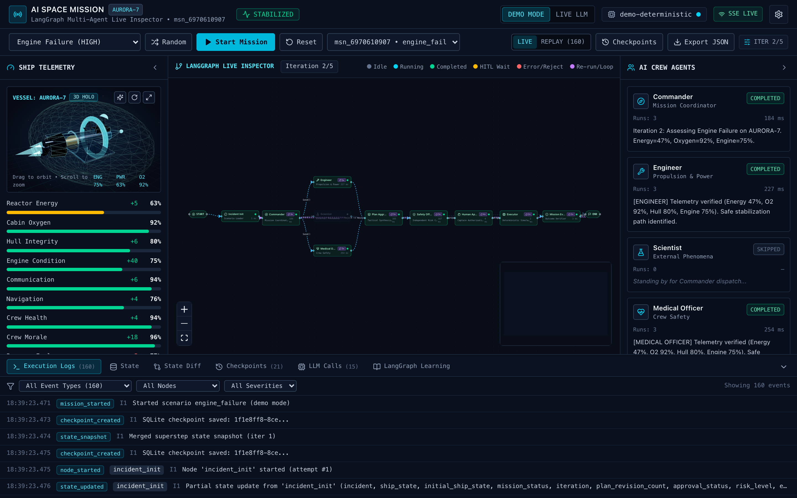
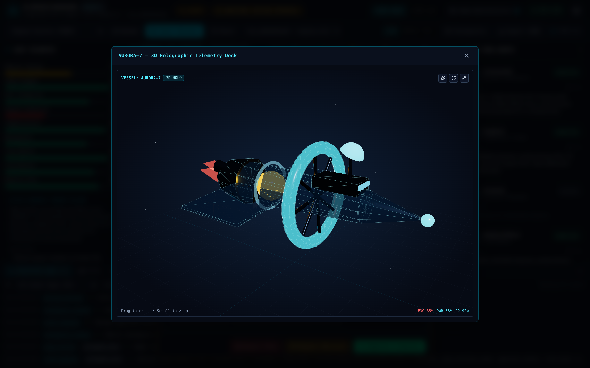
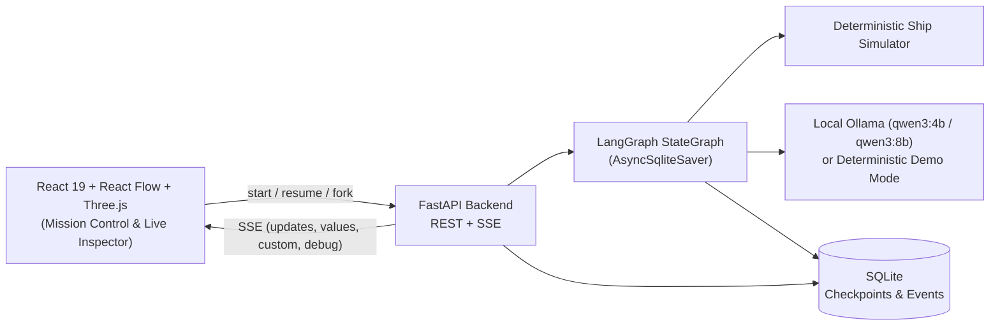

# AI Space Mission — Interactive LangGraph Learning Simulator

[](./.github/workflows/ci.yml)
[](https://langchain-ai.github.io/langgraph/)
[](https://www.python.org/)
[](https://react.dev/)
[](https://threejs.org/)
[](./LICENSE)

> **Learn LangGraph by watching a real multi-agent `StateGraph` execute, branch in parallel, loop on safety rejections, pause on `interrupt()`, persist checkpoints to SQLite, and fork timelines via Time Travel — all live in your browser.**

**AI Space Mission (AURORA-7)** is an open-source educational simulator built specifically to **demystify LangGraph internals**. Instead of reading static toy scripts, you act as the Captain of deep-space research vessel **AURORA-7** while a real LangGraph multi-agent system resolves emergencies in real time — and a built-in **LangGraph Live Inspector** exposes every node, reducer, superstep diff, checkpoint, and SSE event as it happens.

---

## Preview

### LangGraph Live Inspector & Mission Control
Real-time `StateGraph` execution with parallel `Send()` specialist fan-out, Safety Officer revision loops (`2x`/`3x` badges), ship telemetry deltas, AI Crew panels, and the 6-tab Developer Console (`Execution Logs`, `State`, `State Diff`, `Checkpoints`, `LLM Calls`, `LangGraph Learning`):



### Interactive 3D Hologram of AURORA-7 (Three.js)
Full-screen 3D holographic telemetry deck whose reactor core, gravity ring, thruster plumes, comms pulses, and radiation shield react dynamically to `MissionState`:



---

## Why This Project Exists (Learning LangGraph)

Most LangGraph tutorials print logs to a terminal. This project turns every core LangGraph primitive into something you can **see, click, pause, inspect, replay, and fork**:

| LangGraph Concept | Real Implementation | How to Observe It in the UI |
|---|---|---|
| **`StateGraph` & `TypedDict`** | [`backend/app/state/mission_state.py`](./backend/app/state/mission_state.py) | Open **State** & **State Diff** tabs to see partial updates merged into `MissionState`. |
| **Dynamic Fan-out (`Send()`)** | [`backend/app/graph/routing.py`](./backend/app/graph/routing.py) | Watch `Commander` spawn 2–3 specialists concurrently with `Parallel Send() Branch` badges. |
| **Custom Reducers (Fan-in + Reset)** | [`backend/app/state/reducers.py`](./backend/app/state/reducers.py) | Inspect `specialist_reports` merging parallel outputs and resetting cleanly between iterations. |
| **Conditional Edges & Bounded Cycles** | [`backend/app/graph/routing.py`](./backend/app/graph/routing.py) | Watch `Safety Officer` reject Draft #1 and loop back to `Commander` (`2x` badge on repeated nodes). |
| **Human-in-the-Loop (`interrupt()` + `Command`)** | [`backend/app/graph/nodes.py`](./backend/app/graph/nodes.py) | Graph pauses in amber at `Human Approval`; Approve, Reject, or Request Revision via `Command(resume=...)`. |
| **`AsyncSqliteSaver` Checkpointing** | [`backend/app/persistence/checkpointer.py`](./backend/app/persistence/checkpointer.py) | Refresh the browser mid-mission — the paused graph restores automatically from SQLite. |
| **Time Travel (`aget_state_history` + `aupdate_state`)** | [`backend/app/streaming/manager.py`](./backend/app/streaming/manager.py) | Open **Checkpoints** -> compare snapshots -> click **Fork Time Travel** to branch an alternate timeline. |
| **Multi-Mode Streaming (`updates`, `values`, `custom`, `debug`)** | [`backend/app/streaming/manager.py`](./backend/app/streaming/manager.py) | Watch live SSE events in **Execution Logs**, or scrub read-only history in **Replay** mode. |
| **Node-Level `RetryPolicy`** | [`backend/app/graph/workflow.py`](./backend/app/graph/workflow.py) | Transient LLM parsing errors retry with backoff; offline Ollama fails fast with a clear UI banner. |

For a deep-dive walkthrough of every concept (including *what you would have to build manually without LangGraph*), read **[LANGGRAPH_GUIDE.md](./LANGGRAPH_GUIDE.md)**.

---

## Architecture & Workflow

```mermaid
flowchart LR
    START((START)) --> INIT[incident_init]
    INIT --> CMD[commander]
    CMD -. "Send() Fan-out" .-> ENG[engineer]
    CMD -. "Send() Fan-out" .-> SCI[scientist]
    CMD -. "Send() Fan-out" .-> MED[medical_officer]
    ENG --> AGG[plan_aggregator<br/>Fan-in via Reducer]
    SCI --> AGG
    MED --> AGG
    AGG --> SAFE[safety_officer]
    SAFE -. "Reject -> Revise" .-> CMD
    SAFE -. "Approved" .-> HITL[human_approval<br/>interrupt()]
    HITL -. "Command(revise)" .-> CMD
    HITL -. "Command(approve)" .-> EXEC[executor<br/>Deterministic]
    EXEC --> EVAL[mission_evaluator]
    EVAL -. "Next Iteration" .-> CMD
    EVAL -. "Success / Failure / Limit" .-> END((END))
```



---

## Key Features

- **LangGraph Live Inspector (React Flow)**: Topology loaded directly from `compiled_graph.get_graph()` on the backend — never hardcoded on the frontend. Shows live status colors, parallel branches, execution counts, animated edges, and a click-to-inspect **Node Inspector Drawer**.
- **Interactive 3D Hologram of AURORA-7 (Three.js)**: Orbit/zoom holographic spacecraft whose reactor core, gravity ring, thruster plumes, comms pulses, and radiation shield react in real time to `MissionState` telemetry and active scenarios, with a full-screen modal view.
- **6-Tab Developer Console**: `Execution Logs`, `State` (searchable JSON Tree View), `State Diff`, `Checkpoints` (with Time Travel Fork), `LLM Calls`, and `LangGraph Learning` (in-app code snippets + official doc links).
- **Zero-Cost Local Execution (Demo Mode + Ollama Live Mode)**:
  - **Demo Mode** runs the exact same real LangGraph workflow with deterministic structured agent responses — no API keys or GPU required.
  - **Live Mode** connects to local **Ollama** (`qwen3:4b` or `qwen3:8b`, tuned for 16 GB RAM with `LLM_MAX_CONCURRENCY=1`), plus optional OpenAI-compatible API support.
- **Bilingual UI & Content (EN / RU)**: English by default with instant switching to Russian in Settings (applies to UI, scenarios, graph nodes, learning panel, and new missions).

---

## Quick Start (2 Minutes, No API Keys Required)

### Prerequisites
- **Python 3.11 or 3.12**
- **Node.js 20+** and **npm**
- **Ollama** *(optional — only needed for Live LLM Mode)*

### 1. Clone & Start Backend

```bash
git clone https://github.com/DmitriyRud/langgraph-space-mission.git
cd langgraph-space-mission/backend
python3.12 -m venv .venv
source .venv/bin/activate
pip install -r requirements.txt
cp .env.example .env
uvicorn app.main:app --reload --port 8000
```

### 2. Start Frontend

```bash
cd ../frontend
npm install
npm run dev
```

Open **http://localhost:5173** and click **Start Mission** in **Demo Mode**!

---

## Optional: Running Live Mode with Local Ollama

Tested for **Apple Silicon (16 GB RAM)** using a single shared quantized model across all 5 agents:

```bash
brew install ollama
ollama serve

# Fast default (~4–5 GB RAM):
ollama pull qwen3:4b

# Or higher-accuracy (~7–8 GB RAM):
ollama pull qwen3:8b
```

Configure `backend/.env` (see [`backend/.env.example`](./backend/.env.example)):

```env
LLM_PROVIDER=ollama
OLLAMA_BASE_URL=http://localhost:11434
OLLAMA_MODEL=qwen3:4b
LLM_TEMPERATURE=0.2
LLM_MAX_CONCURRENCY=1
```

Then switch to **LIVE LLM** in the top header.

---

## Emergency Scenarios

| Scenario | Severity | LangGraph Learning Highlight |
|---|---|---|
| **Engine Failure** | High | Default showcase: parallel `Send()`, Safety rejection loop, HITL `interrupt()`, 2-iteration stabilization. |
| **Oxygen Leak** | Critical | Fast passive decay + life-support triage + hazard rejection. |
| **Unknown Signal** | Medium | 3-way parallel specialist fan-out (`scientist`, `engineer`, `medical_officer`). |
| **Solar Storm** | High | Power reallocation, 3D radiation shield activation, multi-domain coordination. |
| **Critical Cascade** | Critical | Multi-system failure requiring staged recovery across multiple bounded iterations. |

---

## Tests & Verification

All automated tests run **without Ollama**:

```bash
# Backend unit, workflow, checkpoint recovery, time-travel & API tests
cd backend && .venv/bin/pytest -v

# Frontend TypeScript strict check & production bundle
cd frontend && npm run build
```

---

## Further Reading

- **[LANGGRAPH_GUIDE.md](./LANGGRAPH_GUIDE.md)** — Detailed breakdown of all 8 LangGraph mechanisms used in this project.
- **[DEMO_SCRIPT.md](./DEMO_SCRIPT.md)** — 5–7 minute guided walkthrough script for demos, workshops, or mentor reviews.
- **[CONTRIBUTING.md](./CONTRIBUTING.md)** — Ideas and guidelines for extending the learning lab.
